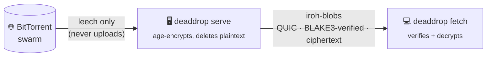

<div align="center">

# 📦 deaddrop

**Leech a torrent on a server. Encrypt it. Hand it to one client, peer to peer. Leave nothing behind.**

🌐 **[deaddrop.rip](https://deaddrop.rip)**

[](https://github.com/asheliahut/deaddrop/actions/workflows/ci.yml)
[](https://github.com/asheliahut/deaddrop/releases)
[](https://github.com/asheliahut/deaddrop/stargazers)
[](https://doc.rust-lang.org/edition-guide/rust-2024/)
[](#-installation)
[](LICENSE)
[](https://deaddrop.rip)
[](https://iroh.computer)
[](https://age-encryption.org)

[Website](https://deaddrop.rip) •
[Quick start](#-quick-start) •
[Installation](#-installation) •
[Usage](#usage) •
[Config](#config-file) •
[Notifications](#notifications) •
[Encryption](#encryption) •
[Contributing](#-contributing)

</div>

---

A server downloads a torrent **without seeding it**, encrypts the result, then
hands the files to a client over [iroh](https://iroh.computer) (peer-to-peer
QUIC with NAT traversal and relay fallback).



## ✨ Features

- 🚫 **Zero seeding** – built on librqbit's `disable-upload`, no incoming BitTorrent listener, and the swarm session is torn down before serving starts.
- 🔐 **End-to-end encrypted** – every file is [age](https://age-encryption.org)-encrypted with a fresh per-torrent key that never touches the server's disk. File names are hidden too.
- 🕳️ **NAT-proof transfers** – iroh punches through NATs and falls back to relays, so neither side needs an open port.
- ✅ **Verified delivery** – every chunk is checked against its BLAKE3 hash; tampering or a wrong key fails loudly.
- 💥 **Single use by default** – one client, one download, then the server shuts down (or wipes the data and waits).
- 🔄 **Hot swaps** – point a running server at a new torrent with `deaddrop reset`; the old ticket dies.
- 🔔 **Notifications** – push tickets to Discord or any webhook, with per-notifier control over who gets the key.
- 🧩 **Script friendly** – `<ticket> <key>` on stdout, everything else on stderr, TOML config, shell completions.

## 🚀 Quick start

```sh
# on the server
deaddrop serve 'magnet:?xt=urn:btih:...'
# ...prints:  <ticket> AGE-SECRET-KEY-1...

# on the client
DEADDROP_KEY=AGE-SECRET-KEY-1... deaddrop fetch <ticket> -o ./downloads
```

That's it. The server exits once the client has everything.

## 📥 Installation

**Prebuilt binaries** for Linux (gnu + musl, x86_64 + aarch64), macOS (Intel +
Apple Silicon) and Windows (x86_64 + ARM) are attached to every
[GitHub release](https://github.com/asheliahut/deaddrop/releases), with
`SHA256SUMS`.

```sh
# example: Linux x86_64 (static musl build)
VERSION=v0.1.0
curl -LO "https://github.com/asheliahut/deaddrop/releases/download/$VERSION/deaddrop-$VERSION-x86_64-unknown-linux-musl.tar.gz"
tar -xzf "deaddrop-$VERSION-x86_64-unknown-linux-musl.tar.gz"
sudo install "deaddrop-$VERSION-x86_64-unknown-linux-musl/deaddrop" /usr/local/bin/
```

**From source** (needs a recent stable Rust toolchain):

```sh
cargo install --locked --git https://github.com/asheliahut/deaddrop
```

## Usage

On the server:

```sh
deaddrop serve 'magnet:?xt=urn:btih:...'          # single use: exits after one client finishes downloading
deaddrop serve https://example.com/x.torrent      # .torrent URLs and local .torrent paths work too
deaddrop serve file.torrent --multi-use           # keep serving to any number of clients until Ctrl-C
deaddrop serve file.torrent --wait-for-reset      # one download per torrent, then wait for the next (needs a reset token)
```

When the torrent finishes, the server encrypts it, deletes the plaintext, and
prints a ticket and a decryption key. On the client:

```sh
export DEADDROP_KEY=AGE-SECRET-KEY-1...           # the key from `serve`
deaddrop fetch <ticket> -o ./downloads
```

See [Encryption](#encryption) for what is protected and from whom.

### `serve` options

| Flag | Meaning |
| --- | --- |
| `--multi-use` | Keep serving to any number of clients until Ctrl-C. Without this flag the server is **single use**: it serves one client, then shuts down (or, with `--wait-for-reset`, deletes the data and waits) once that client has the whole collection and disconnects (or 30 s after the transfer completes). While that client is connected, other clients are rejected. If the client drops out before finishing, the next client can connect. `--multi-use=false` forces single use even if the config file turns multi-use on. |
| `--data-dir <DIR>` | Keep the torrent data and blob store here. If you leave this out, deaddrop uses a temp directory and deletes it on exit. |
| `--peer <IP:PORT>` | Extra BitTorrent peer to connect to. Repeatable. Useful for private swarms. |
| `--notify <TYPE=URL>` | Send the ticket somewhere when it's ready. Repeatable. See [Notifications](#notifications). |
| `--reset-token <TOKEN>` | Let `deaddrop reset` switch the server to a different torrent. See [Resetting a server](#resetting-a-server). Prefer `DEADDROP_RESET_TOKEN` or the config file. |
| `--wait-for-reset` | Single use, needs a reset token: after the one download, delete the data and keep running until a reset brings the next torrent. See [Single use, long running](#single-use-long-running). |
| `-c, --config <FILE>` | TOML config file (works with every command). See [Config file](#config-file). |

`fetch` takes `-o/--out <DIR>` (default: the current directory).

### Resetting a server

A server started with a reset token can be told to serve a different
torrent, without restarting it:

```sh
# server
export DEADDROP_RESET_TOKEN=$(openssl rand -hex 32)
deaddrop serve first.torrent --multi-use

# anywhere that has the ticket and the token
export DEADDROP_RESET_TOKEN=<same token>
deaddrop reset <ticket> 'magnet:?xt=urn:btih:...'   # or an http(s) .torrent URL, or a local .torrent file
```

- The source can be a magnet URI, an http(s) URL (the server fetches it), or
  a local `.torrent` file (its contents are sent to the server). The server
  never treats a reset source as a path on its own disk.
- The server keeps serving the current torrent while the new one downloads.
  If the download fails, nothing changes and `reset` reports the error.
- Once the new torrent is ready, the server prints the new ticket and its new
  decryption key (another line on stdout), sends them to the notifiers with
  `"reset": true`, and `deaddrop reset` prints them too. `--no-wait` returns as soon as the server
  accepts the request.
- **The old ticket stops working.** Transfers already in progress finish, then
  the old torrent's files are deleted, also from a `--data-dir`.
- One reset at a time; a second request is refused while one is downloading.
- Resets use their own iroh protocol (`deaddrop/reset/0`) on the same
  endpoint, which is only enabled when a token is set. The token must be at
  least 16 characters. A wrong token is refused after a short delay.
- Any ticket the server handed out works for `reset`, even one that no
  longer downloads anything: only its endpoint address is used.
- The `reset` command reads its token from `--token`, `DEADDROP_RESET_TOKEN`,
  or `[reset] token` in the config file.
- A single-use server allows one download of each torrent it switches to.
  Without `--wait-for-reset` it still exits after that download.

### Single use, long running

`--wait-for-reset` turns a single-use server into a long-running dead drop
where every torrent can be downloaded exactly once:

```sh
export DEADDROP_RESET_TOKEN=$(openssl rand -hex 32)
deaddrop serve first.torrent --wait-for-reset

DEADDROP_KEY=<key> deaddrop fetch <ticket>    # the one download
deaddrop reset <ticket> 'magnet:?xt=...'      # any ticket from this server works
DEADDROP_KEY=<new key> deaddrop fetch <new ticket>   # each torrent has its own key
```

1. The server serves the torrent to one client, as in normal single use.
2. When that client has everything and disconnects (or 30 s after it has
   everything), the ticket stops working and the torrent's files are deleted.
   The blob store drops its copy within about 10 s. The server keeps running
   but serves nothing.
3. A reset downloads the next torrent and serves it once more, with a new
   ticket. A reset can also replace a torrent nobody has downloaded yet.

Nothing is deleted on Ctrl-C beyond what normal single use does: with
`--data-dir`, a torrent that wasn't downloaded yet stays on disk.

### Shell completions

```sh
deaddrop completions bash > ~/.local/share/bash-completion/completions/deaddrop
deaddrop completions zsh  > ~/.zfunc/_deaddrop        # needs ~/.zfunc in $fpath before compinit
deaddrop completions fish > ~/.config/fish/completions/deaddrop.fish
deaddrop completions powershell >> $PROFILE
source <(deaddrop completions zsh)                   # current session only
```

`deaddrop completions --help` has the full install steps for each shell.
Re-run it after upgrading so new flags complete too.

### Help

`deaddrop --help` (or `deaddrop help <command>`) has the full reference:
examples, environment variables, config precedence and exit codes. `-h` gives
a shorter summary.

Each ticket goes to stdout as one `<ticket> <key>` line, and everything else
goes to stderr. So `deaddrop serve x.torrent > tickets.txt` and then
`read -r TICKET KEY < tickets.txt` works in scripts. After a
[reset](#resetting-a-server), the new ticket and key are printed as another
line.

### Logging

Release builds (`cargo build --release`) log nothing by default. Debug builds
log warnings. Set `RUST_LOG` (e.g. `RUST_LOG=info`) or `log` in the
[config file](#config-file) to change that, or `off` to turn logging off in
any build. This only covers the log output from deaddrop and its libraries.
The status lines (progress, the ticket, reset messages) are always printed to
stderr.

## Config file

Every setting can live in a TOML file. [`config.example.toml`](config.example.toml)
lists all of them, and the binary can print it too:

```sh
deaddrop config example > ~/.config/deaddrop/config.toml   # write a commented template
deaddrop config path                                       # which file is used, and does it exist?
deaddrop config check                                      # validate it and show the settings (secrets hidden)
```

For example:

```toml
log = "off"                       # same syntax as RUST_LOG; "off" = no logs (the release default)

[serve]
multi_use = false
data_dir = "/var/lib/deaddrop"
peers = ["192.168.1.10:6881"]
# reset_token = "<long random string>"     # see "Resetting a server"
# wait_for_reset = false                    # single use: stay up for resets

[[serve.notify]]
type = "discord"
url = "https://discord.com/api/webhooks/<id>/<token>"

[[serve.notify]]
type = "webhook"
url = "https://example.com/hooks/deaddrop"

[fetch]
out = "/home/me/Downloads"

[reset]
# token = "<long random string>"           # used by `deaddrop reset`
```

- **Where it's read from:** `--config <file>` or `DEADDROP_CONFIG`. Otherwise
  deaddrop uses the platform config dir if the file exists:
  `~/.config/deaddrop/config.toml` on Linux (respects `$XDG_CONFIG_HOME`),
  `~/Library/Application Support/deaddrop/config.toml` on macOS,
  `%APPDATA%\deaddrop\config\config.toml` on Windows. A missing default file is
  fine. A missing `--config` file is an error.
- **Precedence:** command-line flag > environment variable > config file >
  default. For lists (`peers`, `notify`) the first source that has any entries
  wins; they aren't merged.
- **Relative paths** (`data_dir`, `out`) are resolved against the config
  file's directory.
- **Typos are errors:** unknown keys or notifier types fail at startup with
  the line and column.
- The file holds secrets once it has webhook URLs or reset tokens. On Unix, deaddrop warns if
  other users can read it (`chmod 600` fixes that).
- The torrent source and the fetch ticket are per-run inputs, so they stay on
  the command line.

## Notifications

The server can send the ticket out when it's ready:

```sh
deaddrop serve x.torrent --notify discord=https://discord.com/api/webhooks/<id>/<token>
deaddrop serve x.torrent --notify webhook=https://example.com/hooks/deaddrop
```

Webhook URLs usually contain a secret. To keep them out of shell history and
`ps`, put them in the [config file](#config-file) as `[[serve.notify]]`
tables, or in `DEADDROP_NOTIFY`, comma-separated:

```sh
export DEADDROP_NOTIFY='discord=https://discord.com/api/webhooks/...,webhook=https://example.com/hook'
deaddrop serve x.torrent
```

Sources aren't merged: `--notify` flags replace `DEADDROP_NOTIFY`, which
replaces the config file's list.

By default a notifier gets the ticket but **not the decryption key**. Choose
per notifier which ones get the key: add `+key` to the type on the command
line (`webhook+key=https://...`) or set `include_key = true` in its
`[[serve.notify]]` table. For example, post the ticket to a Discord channel
and send the key to a private webhook, so a leaked channel alone isn't
enough to read the data.

| Type | What it sends |
| --- | --- |
| `discord` | A channel message with the torrent name, size, mode and a copyable `deaddrop fetch …` command. Mentions are turned off and markdown in the name is escaped. With the key, it is shown as a spoiler, to be set as `DEADDROP_KEY`. |
| `webhook` | `POST` with a JSON body: `{"event": "ticket_ready", "name", "ticket", "fetch_command", "files", "total_bytes", "single_use", "reset"}`, plus `"key"` for notifiers with the key. `reset` is `true` when the ticket replaces an old one after a reset. |

Bad notifier settings are rejected at startup, before the torrent download begins. If a
notification fails (an error status, unreachable host, or the 15 s timeout),
the server logs a warning and keeps serving, since the ticket is still printed
locally. Logs never include webhook URLs.

### Adding a notifier

Notifiers live in `src/notify/`. To add one, for example Slack:

1. Create `src/notify/slack.rs` with a struct that implements the `Notifier`
   trait (`label()` and `send(&Event)`).
2. Register it in `src/notify/mod.rs`: add `mod slack;`, add a
   `Slack { ... }` variant to `NotifierConfig` with the settings it needs,
   and add an arm to the `match` in `NotifierConfig::build`.

The variant's fields are what users write in their `[[serve.notify]]` table
(`type = "slack"` plus those fields). If its main setting is called `url`, the
`--notify slack=<url>` shorthand works with no extra code.

New kinds of events (e.g. "client finished downloading") are variants of the
`Event` enum, and each notifier decides how to render them.

## How "no seeding" works

- The torrent session is built with librqbit's `disable-upload` feature, so it
  never sends piece data to peers.
- There is no incoming BitTorrent listener.
- When the download finishes, the torrent is removed from the session and the
  session (DHT, trackers, peer connections) is stopped before iroh starts
  serving.

## Encryption

The data is encrypted before iroh ever sees it, so it doesn't depend on
trusting iroh's transport or relays:

1. When the torrent finishes, each file is encrypted with
   [age](https://age-encryption.org) to a new X25519 key made for that
   torrent. Each plaintext file is deleted as soon as it is encrypted (so
   you need about one extra file's worth of disk space), and the whole
   download folder is deleted afterwards, also if encryption fails.
2. Only the encrypted files go into the blob store and over iroh. Collection
   entries are named `0`, `1`, ...; the real file names and the torrent name
   are in an encrypted manifest (`deaddrop-manifest.age`).
3. The key lives only in the server's memory. It is printed (stderr and
   stdout) and sent to the notifiers that ask for it, never written to the
   server's disk. Each reset gets a new key.
4. `fetch` downloads the ciphertext, then decrypts each file into place. A
   wrong key or tampered data fails (age authenticates every chunk), and no
   partial file is left under the real name.

What it doesn't hide: file sizes and file count, and that a transfer
happened. The plaintext does exist on the server's disk while the torrent
downloads, and deleting a file doesn't securely erase it (especially on
SSDs). If the server's stderr goes to a persistent log (systemd journal, a
log file), the key ends up there too.

## Notes

- Encrypted files are imported into the iroh blob store by reference, not
  copied, so disk usage isn't doubled.
- The client checks every received chunk against its BLAKE3 hash. It refuses
  file names that are absolute or contain `..`.
- Anyone who has the ticket can download the encrypted data; the key is
  needed to read it. Treat both as secrets, and send them over different
  channels when you can.

## Testing locally

`examples/seed.rs` seeds a local path on 127.0.0.1, so you can test without
the public swarm:

```sh
cargo run --example seed -- ./some-dir       # prints magnet + peer address, writes ./some-dir.torrent
cargo run -- serve ./some-dir.torrent --peer 127.0.0.1:<port>
DEADDROP_KEY=<key> cargo run -- fetch <ticket> -o /tmp/out
```

## 🤝 Contributing

Issues and pull requests are welcome! Before opening a PR, make sure CI will be happy:

```sh
cargo fmt --all
cargo clippy --all-targets --locked -- -D warnings
cargo test --locked
```

Want a new notifier? See [Adding a notifier](#adding-a-notifier). It's about
two files of work.

### Contributors

<a href="https://github.com/asheliahut/deaddrop/graphs/contributors">
  
</a>

## 🙏 Built on

- [iroh](https://iroh.computer) and [iroh-blobs](https://github.com/n0-computer/iroh-blobs): P2P QUIC transport and verified blob transfer
- [librqbit](https://github.com/ikatson/rqbit): the BitTorrent engine
- [age](https://github.com/str4d/rage): file encryption
- [clap](https://github.com/clap-rs/clap), [tokio](https://tokio.rs), and the rest of the Rust ecosystem

## 📜 License

deaddrop is free and unencumbered software released into the public domain.
See [LICENSE](LICENSE) or <https://unlicense.org>.

## ⭐ Star history

<a href="https://star-history.com/#asheliahut/deaddrop&Date">
  <picture>
    <source media="(prefers-color-scheme: dark)" srcset="https://api.star-history.com/svg?repos=asheliahut/deaddrop&type=Date&theme=dark" />
    <source media="(prefers-color-scheme: light)" srcset="https://api.star-history.com/svg?repos=asheliahut/deaddrop&type=Date" />
    
  </picture>
</a>

---

<div align="center">

If deaddrop is useful to you, consider giving it a ⭐. It helps other people find it.

<sub>Use it responsibly: only download and share content you have the right to.</sub>

</div>
